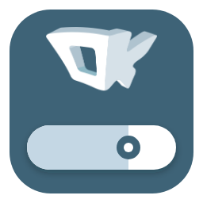
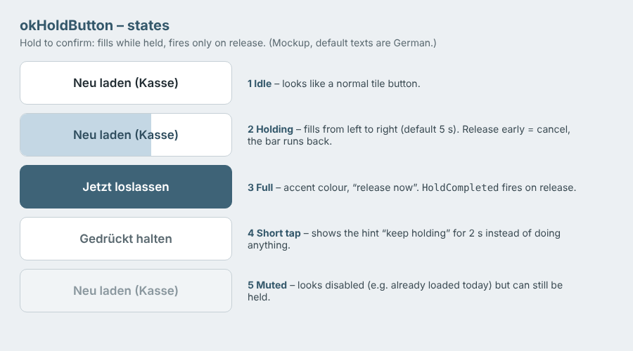

# okHoldButton



**Hold-to-confirm button for Windows Forms** – like the start button in DJI drone apps.
You have to keep it pressed until it is full; the action fires only when you **release** it.
Made for actions that must not happen by accident: reload data, test a connection, delete, change a licence.

Windows Forms has nothing like this (not even in .NET 10). This library fills the gap with one
self-drawn control – plus `TileButton`, a large rounded touch-friendly button it is based on.



## The idea: hold to take off, like a drone

Anyone who has flown a DJI drone knows the pattern: the app does not start the motors on a simple tap.
You press and **hold** the take-off (or landing / return-to-home) button, a ring or bar fills up, and only
then does the drone act. A wrong touch in the pocket or a nervous tap does nothing.

HoldButton brings exactly this behaviour to Windows Forms – for every action where a mistake is
expensive: deleting data, overwriting a database, restarting a service, sending an order.
Unlike a confirmation dialog ("Are you sure? Yes/No") there is no second window that people click away
without reading: the confirmation **is** the hold itself, and you can still back out by letting go early.

## HoldButton vs. TileButton

| | `TileButton` | `HoldButton` |
|---|---|---|
| What it is | large rounded touch button (icon, two text lines, styles) | a `TileButton` that must be held |
| Fires | immediately on click / tap (`Click`) | only after a full hold, on release (`HoldCompleted`) |
| Enter / double-click | trigger it | do nothing |
| Use for | everyday actions: search, print, open settings | actions that must not happen by accident |

Both look the same, so a form stays consistent: HoldButton simply inherits from TileButton and adds
the hold logic.

## Behaviour

1. Press and hold → the button fills from left to right (default: 5 seconds).
2. At 100 % it turns into the accent colour and shows the release text.
3. **Only on release** the `HoldCompleted` event fires.
4. Releasing early or sliding off the button = **cancel**; the bar visibly runs back, nothing happens.
5. A short tap shows a hint (“keep holding”) for 2 seconds – users learn it without a permanent label.

## Highlights

- **Touch-ready:** Windows normally turns a long press on a touch screen into a right-click.
  HoldButton switches that off for itself (`MicrosoftTabletPenServiceProperty`), so tablets and POS touch screens work.
- **No accidental trigger:** a click, Enter or double-click does nothing – only a complete hold.
- **Keyboard:** holding the space bar works the same way.
- **“Greyed out but usable”:** with `TileStyle = Muted` it looks disabled but can still be held.
- **Designer-friendly:** all properties show up in the Visual Studio designer; default event is `HoldCompleted`.
- **DPI-aware:** paddings and corner radii scale with the display.
- No dependencies besides .NET / Windows Forms.

## Usage

```csharp
var btnReload = new OkControls.HoldButton
{
    Text = "Reload data",
    SubText = "Last: 2026-11-07",       // optional second line
    HoldDuration = 5000,                // milliseconds
    ReleaseText = "Release now",        // default texts are German – set your own
    HintText = "Keep holding",
    TileStyle = OkControls.TileStyle.Muted,
    Size = new Size(240, 56)
};
btnReload.HoldCompleted += (s, e) => ReloadData();
```

Add the project `src/OkControls/OkControls.csproj` to your solution (or copy the four `.cs` files).

## Properties (selection)

| Property        | Default             | Meaning                                           |
|-----------------|---------------------|---------------------------------------------------|
| `HoldDuration`  | 5000                | hold time in ms until full                        |
| `ReleaseText`   | „Jetzt loslassen“   | text when full (“release now”)                    |
| `HintText`      | „Gedrückt halten“   | hint after a short tap (“keep holding”), empty = off |
| `HoldFillColor` | #C4D7E4             | fill colour while holding                         |
| `AccentColor`   | #3E6377             | fill at 100 %, primary style, focus frame         |
| `HoldTextColor` | #2F4D5E             | text colour while holding                         |
| `SubText`, `Icon`, `TileStyle`, `CornerRadius` | | inherited from `TileButton`           |
| `Progress`      | 0                   | current fill 0..1 (code only)                     |

## TileButton

The base control (see the comparison above): a large rounded button with icon and optional second line. Styles: `Normal` (white), `Primary` (accent),
`Warning` (orange), `Muted` (grey but usable). Behaves like a normal button (`Click`, `DialogResult`, Enter/Space).

## Requirements

.NET 10, Windows Forms (`net10.0-windows`). Files: `HoldButton.cs`, `TileButton.cs`, `DrawHelper.cs`, `Palette.cs`.
Code comments are German; a German description is in [src/OkControls/LIESMICH.md](src/OkControls/LIESMICH.md).

Originally built for **okPriceTag** by [OnlineKraft](https://onlinekraft.com), a shelf-label printing app for kiosks.

DJI is a trademark of SZ DJI Technology Co., Ltd. This project is not affiliated with or endorsed by DJI;
the name is only used to describe the familiar interaction pattern.

## License

[MIT](LICENSE) © 2026 OnlineKraft UG – version history in [CHANGELOG.md](CHANGELOG.md).
